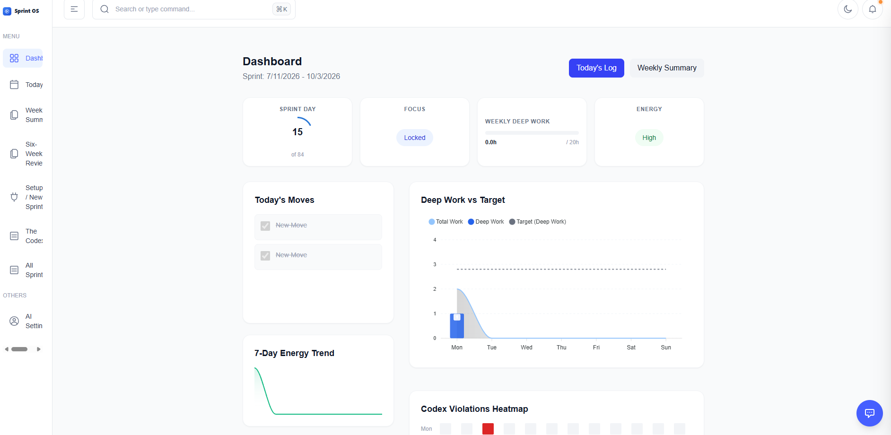

<div align="center">

[](https://binakod.ir/r/codex-grid)

**[🇬🇧 English Portfolio](https://binakod.ir/en/)** &nbsp;•&nbsp; **[🇮🇷 نمونه‌کارها (فارسی)](https://binakod.ir/)**

<sub>*(Automatic language redirection based on visitor preference / هدایت خودکار بر اساس زبان مرورگر)*</sub>

</div>

---

<div align="center">
  
  
  <h1>Sprint OS</h1>
  
  <p><strong>Your Ultimate Engine for Sprints, Codex, and AI-Powered Productivity.</strong></p>

  <p>
    <a href="#features">Features</a> •
    <a href="#screenshots">Screenshots</a> •
    <a href="#tech-stack">Tech Stack</a> •
    <a href="#getting-started">Getting Started</a> •
    <a href="#ai-copilot">AI Copilot</a>
  </p>
</div>

---

## 🚀 About Sprint OS

Sprint OS is a local-first, highly opinionated operating system for your life and work. Designed around the concept of **12-Week Sprints** and **The Codex**, it helps you align your daily actions with your grandest ambitions. 

Instead of endless to-do lists, Sprint OS forces you to define your **North Star**, break it down into Weekly Goals, and execute them day-by-day while adhering to your personal Codex of laws and philosophies.

## ✨ Features

- 🎯 **12-Week Sprint Cycles**: Define your North Star and plan your 12 weeks of focused delivery.
- 📜 **The Codex**: A living document of your personal Doctrine, Blades, Gate Keeper laws, and Final Mission.
- 📅 **Daily & Weekly Tracking**: Log your daily energy, operations, and review your weekly progress.
- 🤖 **Context-Aware AI Copilot**: A built-in AI assistant that has full context of your Codex and active sprint.
- 🔒 **Local & Privacy First**: Your data stays local with SQLite and Prisma.
- ⚡ **Offline Support (PWA)**: Full Progressive Web App support so you can log your days even when disconnected.
- 🔌 **Bring Your Own LLM**: Connect to local LLMs via Ollama, or use OpenAI-compatible APIs directly through an internal SOCKS5 proxy.

## 📸 Screenshots

<div align="center">
  
  <p><em>The Sprint OS Dashboard</em></p>
  
  
  <p><em>The Weekly Summary and Plan</em></p>
</div>

## 🛠 Tech Stack

- **Framework**: Next.js 14 (App Router)
- **Database**: SQLite with Prisma ORM
- **Styling**: Tailwind CSS & Vanilla CSS
- **Charts**: ApexCharts
- **AI Integration**: Node-Fetch with SOCKS5 Proxy support
- **PWA**: `@ducanh2912/next-pwa`

## 🏁 Getting Started

### Prerequisites

- Node.js 18+
- npm or pnpm

### Installation

1. **Clone the repository**
   ```bash
   git clone https://github.com/yourusername/sprint-os.git
   cd sprint-os
   ```

2. **Install dependencies**
   ```bash
   npm install
   ```

3. **Initialize the Database**
   ```bash
   npx prisma db push
   ```

4. **Run the Development Server**
   ```bash
   npm run dev
   ```
   Open [http://localhost:3000](http://localhost:3000) with your browser to see the result.

### Building for Production (Offline Mode)

To enable offline capabilities, you must run a production build:
```bash
npm run build
npm start
```

## 🧠 AI Copilot & Proxy Setup

Sprint OS comes with a highly intelligent AI Copilot that automatically reads your Codex and Sprint goals to give you personalized advice.

**To configure the AI:**
1. Navigate to the **AI Settings** tab in the sidebar.
2. Select **Ollama** (for local privacy) or **OpenAI Compatible**.
3. (Optional) Enable the **SOCKS5 Proxy** if you are behind a corporate firewall or want to route API traffic securely. The proxy defaults to `socks5://127.0.0.1:1080` and can be customized via the UI or by setting the `INTERNAL_PROXY` environment variable.

---

<div align="center">
  Built with discipline.
</div>
